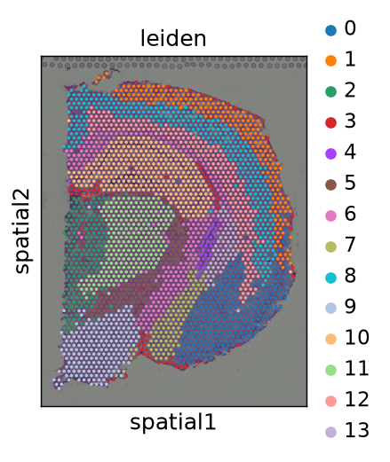
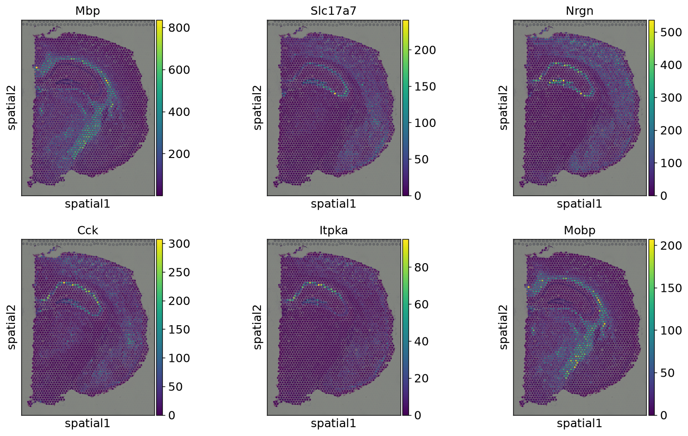
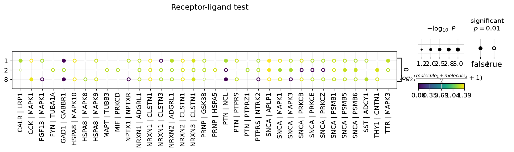

# Spatial Transcriptomics: 10x Visium (mouse brain) with Scanpy + Squidpy

[](https://github.com/syed1789/spatial-visium-squidpy/actions/workflows/ci.yml)

End-to-end spatial analysis of a public 10x Genomics Visium dataset (adult mouse brain coronal section, H&E; 2,688 spots x 18,078 genes), from QC to spatial statistics and ligand-receptor inference. One script, one command, every figure regenerated from scratch.

Data: `squidpy.datasets.visium_hne_adata()` (the Squidpy tutorial copy of the 10x dataset, downloaded automatically on first run, ~330 MB, not committed).

## What it does

| Step | Method | Output |
|---|---|---|
| QC | counts / genes per spot, mito fraction | `01_qc_spatial.png` |
| Embedding + clustering | normalize, log1p, 2000 HVGs, PCA, neighbors, UMAP, Leiden (res 0.6) -> 14 clusters | `02_umap_leiden.png`, `03_spatial_leiden.png`, `cluster_assignments.csv` |
| Spatial graph | hex-grid neighbors (6) | used by all steps below |
| Neighborhood enrichment | permutation z-scores per cluster pair | `04_nhood_enrichment.png` |
| Co-occurrence | cluster co-occurrence vs distance | `05_co_occurrence.png` |
| Spatially variable genes | Moran's I (100 permutations, FDR) | `06_top_spatially_variable_genes.png`, `moran_top50.csv` |
| Ligand-receptor | Squidpy `ligrec` (permutation test, Omnipath resource) | `07_ligand_receptor.png`, `ligrec_means.csv`, `ligrec_pvalues.csv` |

## Results

Leiden clusters recover the anatomical layering of the section (cortical layers, hippocampus, fiber tracts, thalamic/hypothalamic regions):



Top spatially autocorrelated genes by Moran's I are canonical brain markers, a useful sanity check: *Mbp* (I = 0.79), *Slc17a7* (0.78), *Nrgn* (0.74), *Cck* (0.73), *Itpka* (0.70), *Mobp* (0.70). The myelin genes (*Mbp*, *Mobp*) trace the white-matter tracts, and *Slc17a7*, *Nrgn*, *Cck* and *Itpka* mark the hippocampal pyramidal layer (colour bars show raw counts).



Neighborhood enrichment and co-occurrence: `results/figures/04_nhood_enrichment.png`, `05_co_occurrence.png`.

Ligand-receptor (cluster 0 as sender to clusters 1, 2, 8; mean > 1.3, p < 0.01 filter for display, the full tables are written to `results/ligrec_*.csv` by the script and are not committed, 26 MB):



## Run it

```bash
python -m venv .venv && source .venv/bin/activate
pip install -r requirements.txt
python analyze_visium.py --outdir results
```

Container (built and run on Docker Desktop, linux/arm64; produces identical cluster assignments and Moran's I to within 1e-10 of the native run. The image installs `g++` because `mahotas`, a Squidpy dependency, has no ARM wheel):

```bash
docker build -t spatial-visium-squidpy .
docker run --rm -v $PWD/results:/work/results spatial-visium-squidpy
```

Versions are pinned in `requirements.txt` (scanpy 1.12.5, squidpy 1.8.4, Python 3.13 used for the committed results). Seeds are fixed (`--seed 0`).

## Caveats

- Clusters are numbered arbitrarily and are not annotated to brain regions here; the anatomical reading above is visual, not a formal label transfer.
- Ligand-receptor results are cluster-level permutation tests on spot data (each spot mixes several cells), so treat them as hypotheses.
- No cell-type deconvolution (cell2location / Tangram) yet; that needs a matched scRNA-seq reference.

## Reference

Palla G, Spitzer H, et al. *Squidpy: a scalable framework for spatial omics analysis.* Nature Methods, 2022.

## Running on HPC (SLURM) and AWS

Includes `run_analysis.sh` (Docker or Apptainer), a SLURM job script, and a one-shot EC2 launcher. See [HPC_AWS.md](HPC_AWS.md) for steps and what was verified.
